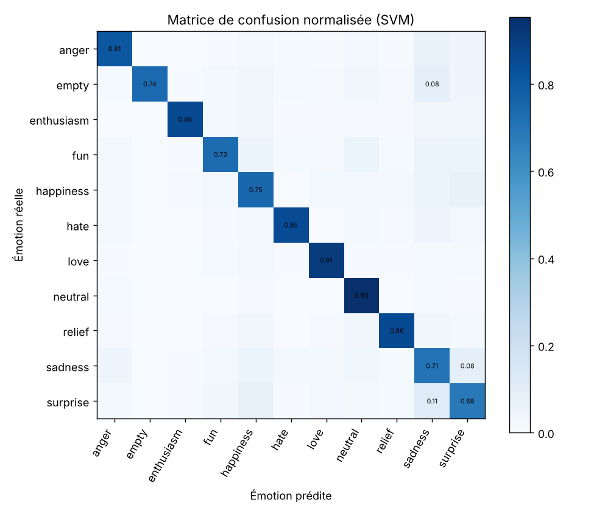
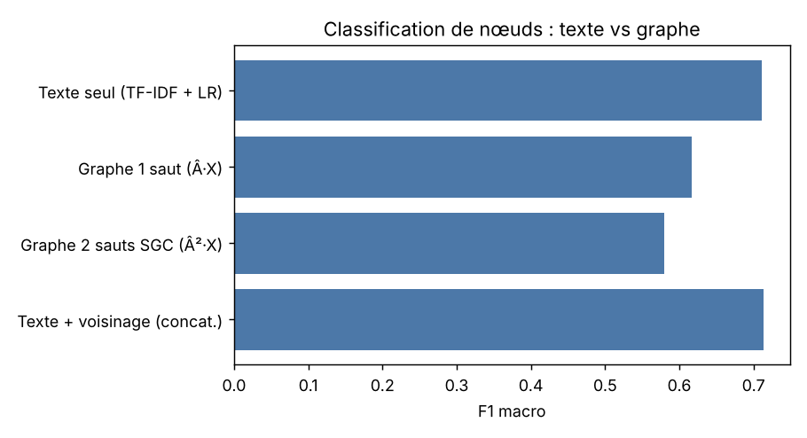
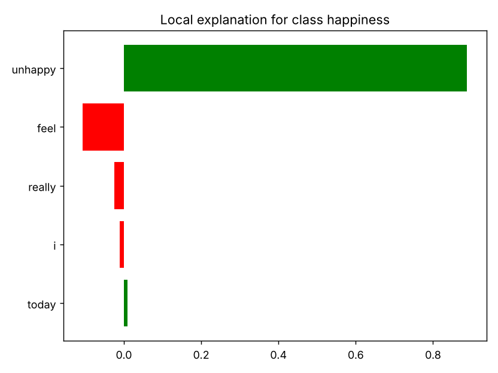

# Analyse de sentiments : polarité et émotions

Projet de Data Mining (ING Info 2, 2026-2027) : classer des textes en anglais selon leur **polarité** (3 classes) et leur **émotion** (11 classes), puis tester si un **graphe de textes** (mots-clés communs) améliore la prédiction.

**Auteurs :** Ala Eddine Saihi, Jawaher Fakraoui — **Encadrante :** Mariem Ghzara

## État d'avancement
- [x] **Phase 1** : business understanding, collecte, compréhension et préparation des données, graphe de textes
- [x] **Phase 2** : modélisation (baselines, polarité, validation croisée, classification de nœuds)
- [x] **Phase 3** : explication (mots influents, LIME), application de démonstration, rapport final

## Résultats principaux
Jeu nettoyé : 79 565 textes (25,2 % supprimés : doublons, contradictions, textes trop courts ou trop longs). Découpage stratifié 63 652 / 15 913.

| Modèle (jeu de test) | Exactitude | F1 macro |
|---|---|---|
| Tirage au hasard (11 émotions) | 9,3 % | 8,8 % |
| SVM linéaire, 11 émotions | 80,8 % | 81,4 % |
| Régression logistique, 11 émotions | 79,6 % | 80,3 % |
| SVM linéaire, polarité (3 classes) | 84,7 % | 83,8 % |

Validation croisée à 5 plis (SVM, 11 émotions) : F1 macro 81,4 % ± 0,3 point.

**Le graphe n'améliore pas la prédiction** (classification de 6 000 nœuds, F1 macro) : texte seul 71,1 %, texte + voisinage 71,3 %, voisinage seul 61,7 % (1 saut) et 58,0 % (2 sauts). Le graphe contient pourtant un signal réel : 30,7 % des arêtes relient deux textes de même émotion, contre 9,7 % au hasard.




## Limite importante : la qualité des étiquettes
Une partie des étiquettes du jeu semble venir d'une recherche automatique de mots-clés, y compris à l'intérieur d'autres mots : 83 % des textes contenant « average » sont étiquetés *anger* (le mot contient « rage »), 97 % de ceux contenant « avoid » sont étiquetés *empty* (« void »), 86 % de ceux contenant « unhappy » sont étiquetés *happiness*. Le modèle apprend cette règle de surface : il ne comprend ni la négation ni le sarcasme. L'explication locale (LIME) le confirme : un seul mot décide de la prédiction. Les scores ci-dessus sont donc à lire avec prudence.



## Structure
```
code/     phase1_pipeline.py, phase2_modeling.py (scripts) et les notebooks exécutés
          phase1_projet_sentiments.ipynb, phase2_modelisation.ipynb
plots/    12 graphiques générés par le code
report/   rapport_phase1 (Word et PDF) et rapport_final (Word)
app/      application de démonstration Streamlit
data/     voir data/README.md (données à télécharger)
```

## Utilisation
```bash
pip install -r requirements.txt
# 1) télécharger le jeu de données (voir data/README.md) dans data/raw/final_dataset.csv
cd code
python phase1_pipeline.py      # nettoyage, TF-IDF, graphe -> data/processed et plots 01 à 08
python phase2_modeling.py      # modèles, validation croisée, LIME -> plots 09 à 12
```
Les graines aléatoires sont fixées (42). Selon la version de scikit-learn, un score peut varier de ±0,0001.

**Application de démonstration** (après avoir lancé `phase1_pipeline.py`) :
```bash
cd app
streamlit run app.py
```
Au premier lancement, l'application entraîne le modèle (environ 30 secondes). Elle propose une règle de négation, un correctif ciblé pour des cas comme « unhappy » ; décochée, elle montre le modèle seul.

## Données et licence
Données : « Text Emotion » (Kaggle, prajwalnayakat), fusion de trois jeux Kaggle ; usage académique. Les données ne sont pas incluses dans ce dépôt. Code sous licence MIT (voir `LICENSE`).

